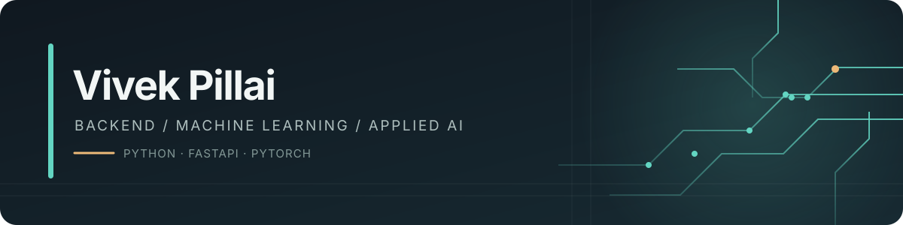

  

<table>
  <tr>
    <td valign="middle">
      I build backend systems and machine learning applications, with a focus on generative AI, agent evaluation, and computer vision.  
      <a href="mailto:pillaivivek200@gmail.com">Email</a> ·
      <a href="https://github.com/vivzz2216">GitHub</a>
        
      Open to Backend and AI/ML opportunities
    </td>
    <td width="150" align="center" valign="middle">
       
      <a href="https://giphy.com/explore/pixel-cats-stickers">Animated pixel cat sticker · GIPHY</a>
    </td>
  </tr>
</table>

---

## Selected work

| Project | Description |
| --- | --- |
| [Qwen 2.1 Image Studio](https://github.com/vivzz2216/gwen-2.1-image-generation) | Diffusion image generation pipeline and creative workflow studio. |
| [ETHOS AI Evaluator](https://github.com/vivzz2216/ethos-ai-evaluator) | Automated evaluation and benchmarking framework for intelligent systems. |
| [CampusHub](https://github.com/vivzz2216/CampusHub) | Student and campus collaboration and resource management platform. |
| [Face2Phase](https://github.com/vivzz2216/face2phase) | Computer vision and biometric facial processing application. |
| [Pastebin Lite](https://github.com/vivzz2216/pastebin-lite) | Lightweight paste and snippet sharing service. |

## Toolkit

**Machine learning** · Python · PyTorch · Hugging Face · Diffusers · Ollama · OpenCV  
**Backend** · FastAPI · Node.js · PostgreSQL · Docker  
**Frontend** · TypeScript · JavaScript · React · Next.js · Tailwind CSS · Vite

  Thanks for stopping by · <a href="mailto:pillaivivek200@gmail.com">Get in touch</a>

