


  

&nbsp;
&nbsp;

  

**Backend & ML engineer** who builds autonomous agents, multimodal LLM workflows and full-stack platforms. 
Open to Backend and AI/ML roles — [say hello](mailto:pillaivivek200@gmail.com).

 


  

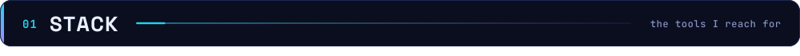
 
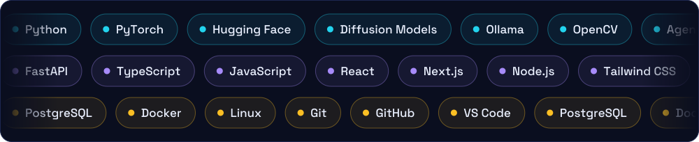

  

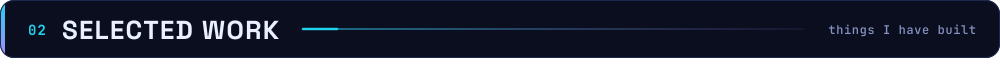
 

<a href="https://github.com/vivzz2216/gwen-2.1-image-generation"></a>
<a href="https://github.com/vivzz2216/ethos-ai-evaluator"></a>
 
<a href="https://github.com/vivzz2216/CampusHub"></a>
<a href="https://github.com/vivzz2216/face2phase"></a>
 
<a href="https://github.com/vivzz2216/pastebin-lite"></a>
<a href="https://github.com/vivzz2216?tab=repositories">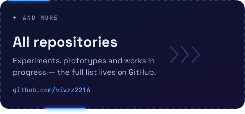</a>

  

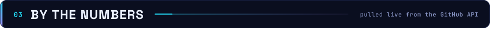
 

  

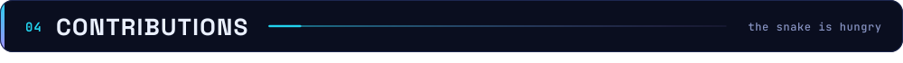
 
<picture>
  <source media="(prefers-color-scheme: dark)" srcset="https://raw.githubusercontent.com/vivzz2216/vivzz2216/output/github-snake-dark.svg" />
  
</picture>

  

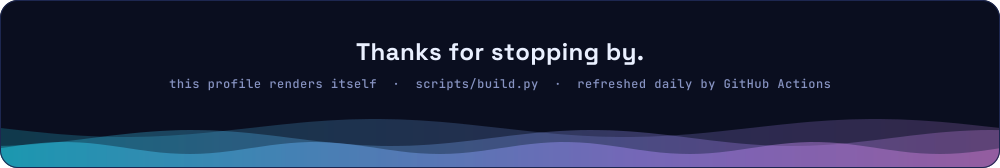

