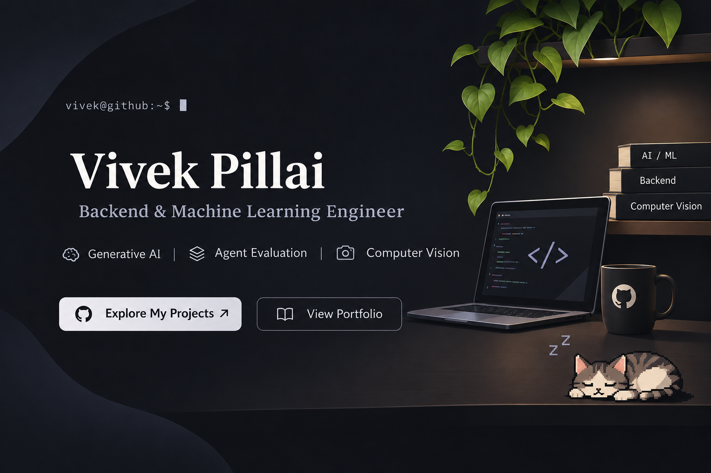

<div align="center">

  <!-- Cozy Studio Desk Banner -->
  

  <br/><br/>

  <!-- Quick Action Buttons matching the Banner -->
  <a href="https://github.com/vivzz2216?tab=repositories">
    
  </a>
  &nbsp;&nbsp;&nbsp;&nbsp;
  <a href="https://backroom-theme-portfolio.vercel.app">
    
  </a>

  <br/><br/>

</div>

---

### 💻 System Terminal

```yaml
User:        vivek@github:~$
Name:        Vivek Pillai
Role:        Backend & Machine Learning Engineer
Core Focus:  Generative AI • Agent Evaluation • Computer Vision
Stack:       Python, PyTorch, Transformers, FastAPI, TypeScript, PostgreSQL, Docker
Portfolio:   https://backroom-theme-portfolio.vercel.app
Bio:         Crafting robust distributed backends and reliable neural architectures.
```

---

### 🚀 Selected Work & Repositories

| Project | Description | Tech Stack | Proof |
| :--- | :--- | :--- | :--- |
| [**face2phase**](https://github.com/vivzz2216/face2phase) | Computer vision pipeline for facial structure to optical phase reconstruction. | `Python` `OpenCV` `PyTorch` | [Inspect Code ↗](https://github.com/vivzz2216/face2phase) |
| [**ethos-ai-evaluator**](https://github.com/vivzz2216/ethos-ai-evaluator) | Comprehensive benchmarking suite and evaluation harness for autonomous LLM agents. | `Python` `LLMs` `Evaluation` | [Inspect Code ↗](https://github.com/vivzz2216/ethos-ai-evaluator) |
| [**gwen-2.1-image-generation**](https://github.com/vivzz2216/gwen-2.1-image-generation) | Diffusion-based generative vision pipeline and custom low-latency inference wrapper. | `Python` `Diffusers` `PyTorch` | [Inspect Code ↗](https://github.com/vivzz2216/gwen-2.1-image-generation) |
| [**Drona-AI**](https://github.com/vivzz2216/Drona-AI) | Contextual retrieval assistant and intelligent multi-step reasoning agent. | `FastAPI` `LangChain` `Vector DB` | [Inspect Code ↗](https://github.com/vivzz2216/Drona-AI) |
| [**veruance**](https://github.com/vivzz2216/veruance) | High-fidelity frontend design system and interactive component architecture. | `TypeScript` `CSS` `React` | [Inspect Code ↗](https://github.com/vivzz2216/veruance) |

---

### 🛠️ Technical Stack & Tooling

```
  Core Languages     ❯  Python  •  TypeScript  •  Go  •  SQL  •  C++
  AI & Deep Learning ❯  PyTorch  •  Transformers  •  Diffusers  •  OpenCV  •  Hugging Face
  Backend & Systems  ❯  FastAPI  •  Node.js  •  PostgreSQL  •  Redis  •  REST / gRPC
  Infrastructure     ❯  Docker  •  Linux  •  CI/CD Pipelines  •  GitOps  •  Vercel
```

---

<div align="center">
  <sub>Handcrafted for <a href="https://github.com/vivzz2216">@vivzz2216</a> · Cozy Desk Setup Design</sub>
</div>
